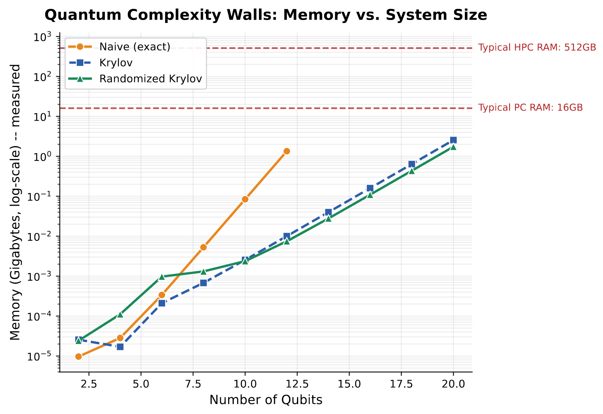
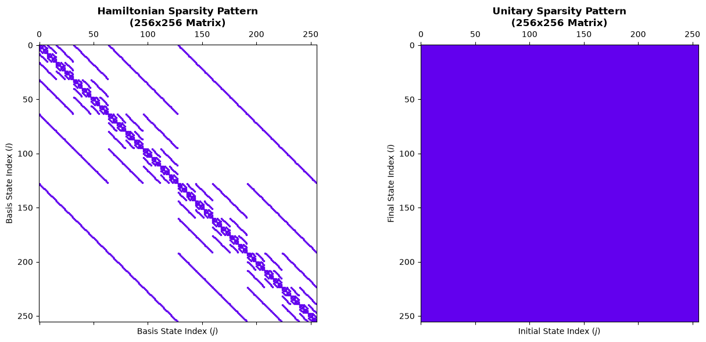
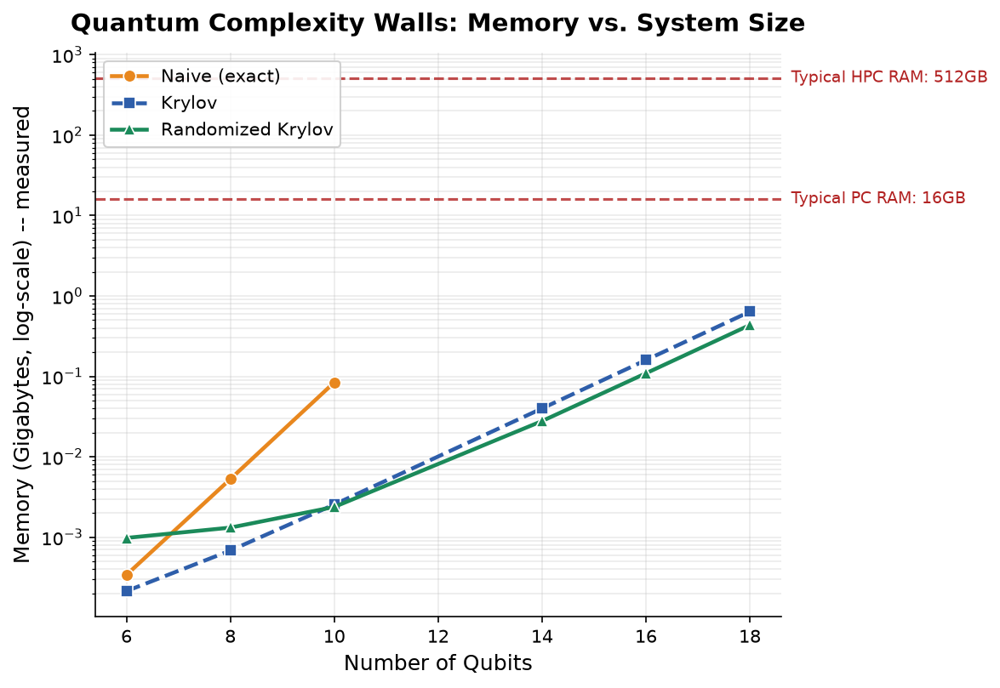
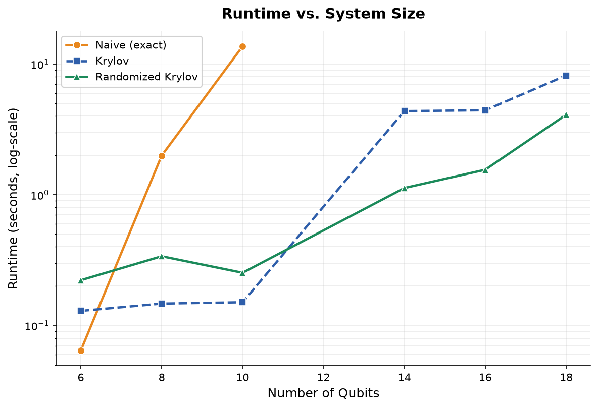

# RandQuantKry

**A RandNLA-accelerated Krylov subspace solver for quantum time evolution.**

<p align="center">
  
</p>

Simulating quantum dynamics classically hits an exponential wall: the state vector of an
*n*-qubit system lives in a 2ⁿ-dimensional space, and exact methods scale accordingly. This
project explores how far that wall can be pushed back using **randomized numerical linear
algebra (RandLA)** combined with **Krylov subspace methods** and, more specifically, *why*
that reach is bounded by the same physics that governs the problem in the first place:
[Lieb–Robinson bounds](https://en.wikipedia.org/wiki/Lieb%E2%80%93Robinson_bounds) limit how
fast information spreads through a local Hamiltonian, which in turn sets how large a Krylov
subspace is actually needed for a given system size and simulation time.

Rather than diagonalizing a dense N×N matrix (`naive`) or paying full O(m²N) reorthogonalization
costs (`krylov`), this package builds Krylov subspaces using **sparse matrix-vector products**
and a **fast randomized sketch** (Güttel & Schweitzer's sketched-FOM, with a truncated
reorthogonalization made numerically safe by a periodic sketch-based correction). 

## Key features

- **Time-evolution methods** (`evolution.py`, `trotter.py`):
  - `naive` — exact diagonalization (ground truth, feasible only up to ~14 qubits)
  - `krylov` — deterministic Lanczos, full reorthogonalization
  - `randomized_krylov` — sketched Krylov (fast SRTT/DCT sketch, truncated reorthogonalization,
    sketch-QR correction)
  - `randomized_krylov_gaussian` — the same algorithm with a dense Gaussian sketch, kept as an
    explicit comparison baseline (see *Known limitations* below)
  - `trotter` — first/second-order Trotter-Suzuki product formula (via Qiskit), representing
    what an actual quantum computer would run
- **Benchmark suite** (`benchmark.py`, class `Benchmark`) — runtime and memory sweeps
  across system size, plus a verification/validation split:
  - `verify_consistency` — internal sanity checks (state norm ≈ 1, no NaN/Inf) that don't need
    ground truth
  - `validate_accuracy` — comparison against exact diagonalization or a self-convergence proxy
    beyond the exact-diagonalization qubit limit
  - `parameter_study` — a tidy `pandas`-based sweep across `n_qubits`, `krylov_dim`,
  sketch-to-Krylov-dimension ratio, and evolution time.
- **Reproducible runs** (`utils/reproducible_runs.py`) — every parameter-study and benchmark run writes 
  its configuration, package versions, and results incrementally to output directory.

## Installation

This project uses [`uv`](https://github.com/astral-sh/uv) for fast, reproducible dependency
management.

```bash
git clone <repo-url>
cd randquantkry
uv sync --extra dev
```

To use notebooks with this project's environment (RECOMMENDED):

```bash
uv add --dev ipykernel
uv run python -m ipykernel install --user --name randquantkry --display-name "randquantkry (uv)"
```

Then select **"randquantkry (uv)"** as the kernel in Jupyter/VS Code. You might need to restart VSCode to find the new kernel. Alternatively, run `uv run --extra dev jupyter lab` to launch Jupyter directly inside the project's
environment without registering a persistent kernel.

If you prefer `pip`:

```bash
python -m venv .venv
source .venv/bin/activate # Linux (or Mac)
.venv\Scripts\activate.bat # Windows  
pip install -e ".[dev]"
```

## Where to start ?

### Interactive Walkthroughs & Tutorials

For hands-on, step-by-step introductions to the package, explore the interactive Jupyter notebooks in the **[`scripts`](scripts/)** directory:

1. **[`scripts/tutorial.ipynb`](scripts/tutorial.ipynb)** - **Getting Started**: An overview covering Hamiltonian construction and naive quantum state evolution.
<p align="center">
  
</p>

2. **[`scripts/tutorial_evolution_methods.ipynb`](scripts/tutorial_evolution_methods.ipynb)** - **Evolution Algorithms**: Dive into the available time-evolution solvers (Krylov, Randomized Krylov) and a introductory comparison of accuracy

3. **[`scripts/tutorial_benchmarking.ipynb`](scripts/tutorial_benchmarking.ipynb)** - **Benchmarking Workflows**: Shows how to benchmark runtime and memory scaling across different qubit sizes and methods.

<p align="center">
  
  
</p>

4. **[`scripts/tutorial_parameter_study.ipynb`](scripts/tutorial_parameter_study.ipynb)** - **Parameter Sweeps & Analysis**: How to run multi-variable parameter grids, save structured run artifacts, load JSONL logs, and plot post-processing metrics.

## Project structure

```
randquantkry/
├── src/
│   ├── hamiltonian.py       # Pauli-string Hamiltonian construction + resizing
│   ├── evolution.py         # naive, krylov, randomized_krylov(_gaussian)
│   ├── trotter.py           # Trotter-Suzuki product formula (via Qiskit)
│   ├── benchmark.py         # Benchmark: runtime/memory sweeps, verify/validate, parameter_study
│   └── plotting.py          # consistent styling across all result plots
├── utils/
│    ├── logging_config.py     # structured console + JSON-lines logging
│    ├── meta_metadata_file_generator.py   # creates a table to map the unique run_ids to their metadata
│    └──reproducible_runs.py   # gives benchmarking and parameter runs unique run_ids and output directories
│     
├── scripts/
│   ├── tutorial.ipynb                      # Basics tutorial: setup hamiltonian, initial state and first run
│   ├── tutorial_evolution_methods.ipynb    # Tutorial to show other methods
│   ├── tutorial_benchmarking.ipynb         # Tutorial for benchmarking
│   └── tutorial_parameter_studying.ipynb   # Tutorial for parameter study
├── tests/                                # pytest suite (hamiltonian, evolution, benchmark, verification)
├── results/                              # timestamped parameter-study output
├── docs/                                 # documentation setup
├── pyproject.toml
├── uv.lock
└── .gitlab-ci.yml
```

## Testing

```bash
uv run pytest --cov=randquantkry
```

To test the CI pipeline itself locally before pushing (catches YAML/config issues without
waiting for a real pipeline run):

```bash
gitlab-ci-local              # full pipeline
gitlab-ci-local unit-tests   # a single job
```

## Known limitations

- **`num_random_vectors` must exceed `krylov_dim`** (roughly `2*krylov_dim + 1`) for the
  sketch-QR correction to be well-defined, and can never exceed `2**n_qubits`. Both `krylov_dim`
  and `num_random_vectors` are automatically clamped with a logged warning if a sweep would
  otherwise request something outside this range.
- **`randomized_krylov_gaussian` is a deliberate baseline, not a recommended method.** It uses a
  dense Gaussian sketch instead of the fast SRTT/DCT sketch. Theoretically similar accuracy,
  but with a genuinely worse memory footprint (O(s·N) for the sketch matrix itself) and, once
  `H` is sparse, no real speed advantage over deterministic Krylov. Kept for comparison, not
  for production use.
- **Memory grows with both `n_qubits` and `krylov_dim`.** Check feasibility *before* running a large sweep.

## References

This implementation is built on:

- Güttel, S., & Schweitzer, M. (2023). *Randomized sketching for Krylov approximations of
  large-scale matrix functions.* SIAM Journal on Matrix Analysis and Applications.
- Balabanov, O., & Grigori, L. (2022). *Randomized Gram-Schmidt process with application to GMRES.*
- Martinsson, P.-G., & Tropp, J. A. (2020). *Randomized numerical linear algebra: Foundations
  and algorithms.* Acta Numerica.
- Tropp, J. A. (2011). *Improved analysis of the subsampled randomized Hadamard transform.*

## License

MIT — see `LICENSE`.