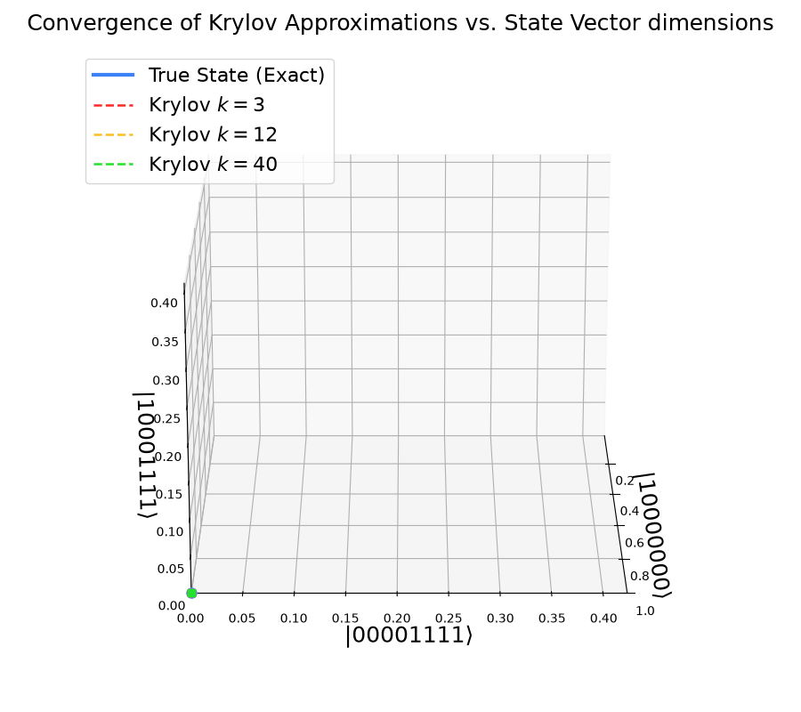
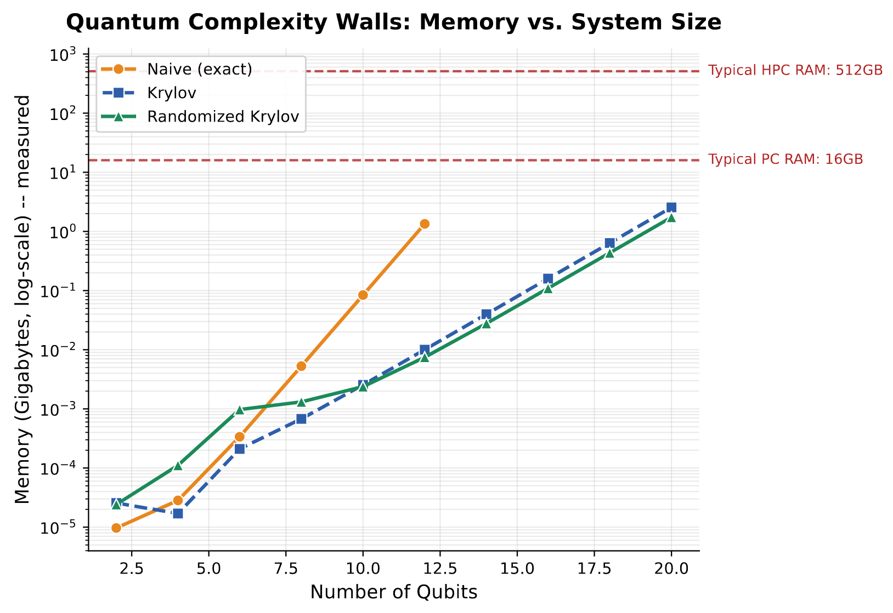

# RandQuantKry


**A RandNLA-accelerated Krylov subspace solver for quantum time evolution.**

<p align="center">
  
</p>

Simulating quantum dynamics classically hits an exponential wall: the state vector of an
*n*-qubit system lives in a 2ⁿ-dimensional space, and exact methods scale accordingly. This
project explores how far that wall can be pushed back using **randomized numerical linear
algebra (RandLA)** combined with **Krylov subspace methods**.

<p align="center">
  
</p>

Rather than diagonalizing a dense N×N matrix (`naive`) or paying full O(m²N) reorthogonalization
costs (`krylov`), this package builds Krylov subspaces using **sparse matrix-vector products**
and a **fast randomized sketch** (`randomized_krylov`) using Güttel & Schweitzer's sketched-FOM,
with a truncated reorthogonalization made numerically safe by a periodic sketch-based
correction.

## Key features

| Method | Description |
|---|---|
| `naive` | Exact diagonalization — ground truth, feasible only up to ~14 qubits |
| `krylov` | Deterministic Lanczos with full reorthogonalization |
| `randomized_krylov` | Sketched Krylov (fast SRTT/DCT sketch, truncated reorthogonalization, sketch-QR correction) |
| `randomized_krylov_gaussian` | Same algorithm with a dense Gaussian sketch — comparison baseline only |
| `trotter` | First/second-order Trotter-Suzuki product formula (via Qiskit) |

Plus a full **benchmark suite** (runtime/memory sweeps, `verify_consistency`, `validate_accuracy`,
`parameter_study`) and **reproducible run tracking** that logs configuration, package versions,
and results incrementally.

## Project structure

```
randquantkry/
├── src/
│   ├── hamiltonian.py       # Pauli-string Hamiltonian construction + resizing
│   ├── evolution.py         # naive, krylov, randomized_krylov(_gaussian)
│   ├── trotter.py           # Trotter-Suzuki product formula (via Qiskit)
│   ├── benchmark.py         # Benchmark: runtime/memory sweeps, verify/validate, parameter_study
│   └── plotting.py          # consistent styling across all result plots
├── utils/
│   ├── logging_config.py              # structured console + JSON-lines logging
│   ├── meta_metadata_file_generator.py # maps run_ids to metadata
│   └── reproducible_runs.py           # unique run_ids and output directories
├── scripts/                 # tutorial notebooks
├── tests/                   # pytest suite
├── results/                 # timestamped parameter-study output
└── docs/                    # this documentation
```

## References

- Güttel, S., & Schweitzer, M. (2023). *Randomized sketching for Krylov approximations of
  large-scale matrix functions.* SIAM Journal on Matrix Analysis and Applications.
- Balabanov, O., & Grigori, L. (2022). *Randomized Gram-Schmidt process with application to GMRES.*
- Martinsson, P.-G., & Tropp, J. A. (2020). *Randomized numerical linear algebra: Foundations
  and algorithms.* Acta Numerica.
- Tropp, J. A. (2011). *Improved analysis of the subsampled randomized Hadamard transform.*

## License

MIT — see [`LICENSE`](https://gitlab.git.nrw/felicia.erb/randquantkry/-/blob/main/LICENSE).