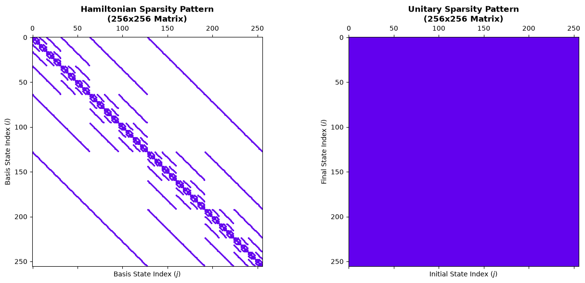
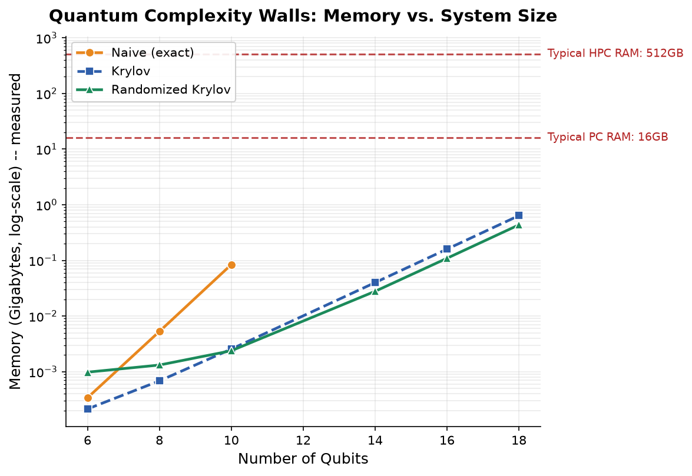
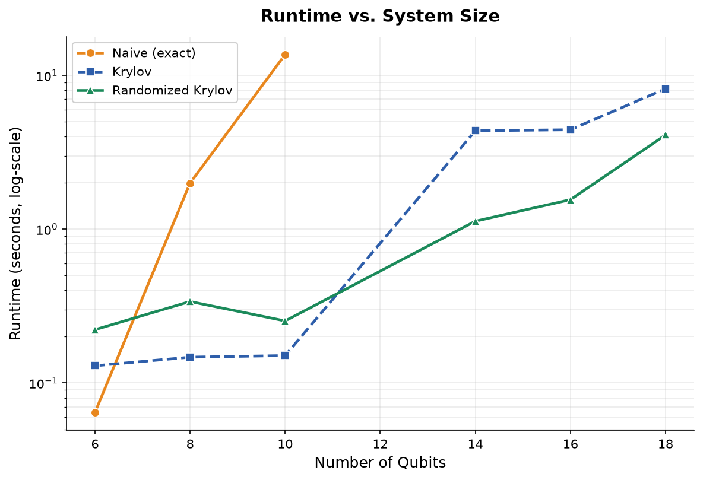
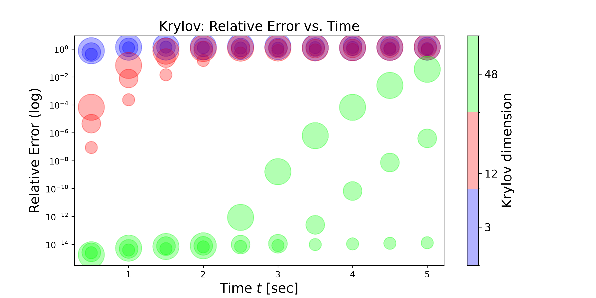
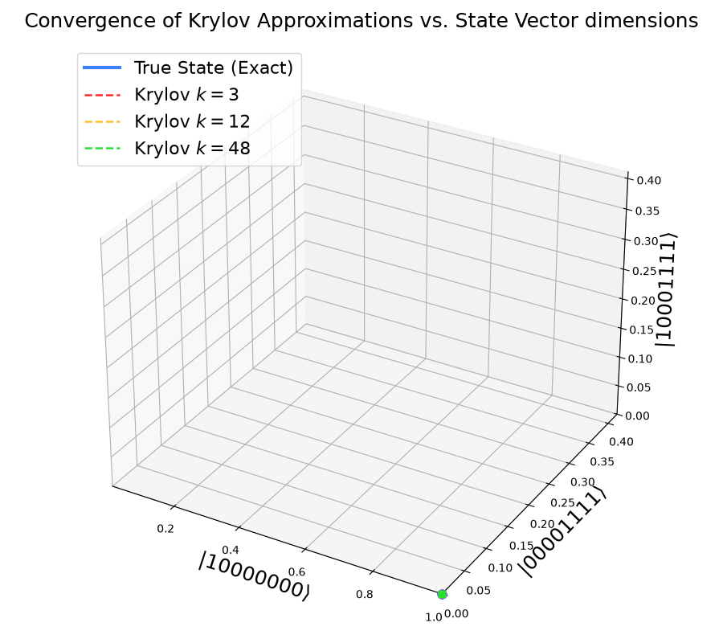
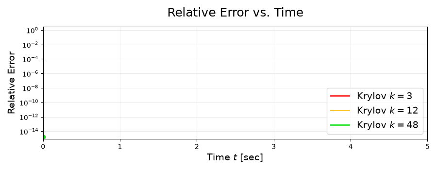

# Notebook Walkthroughs

Jupyter notebooks. The `tutorial_*.ipynb` series is a hands-on walkthrough of the
package.

## 1. Getting started

**[`tutorial.ipynb`](https://gitlab.git.nrw/felicia.erb/randquantkry/-/blob/main/scripts/tutorial.ipynb)**
— building a Hamiltonian, constructing an initial state, and running naive time evolution.

  

## 2. Evolution algorithms

**[`tutorial_evolution_methods.ipynb`](https://gitlab.git.nrw/felicia.erb/randquantkry/-/blob/main/scripts/tutorial_evolution_methods.ipynb)**
— the available time-evolution solvers (Krylov, randomized Krylov) and an introductory
accuracy comparison between them.

## 3. Benchmarking workflows

**[`tutorial_benchmarking.ipynb`](https://gitlab.git.nrw/felicia.erb/randquantkry/-/blob/main/scripts/tutorial_benchmarking.ipynb)**
— how to benchmark runtime and memory scaling across qubit counts and methods using the
`Benchmark` class.

  
  

## 4. Parameter sweeps & analysis

**[`tutorial_parameter_study.ipynb`](https://gitlab.git.nrw/felicia.erb/randquantkry/-/blob/main/scripts/tutorial_parameter_study.ipynb)**
— how to run multi-variable parameter grids, save structured run artifacts, load JSONL logs,
and plot post-processing metrics.

## 5. Fun visuals for parameter study

**[`tutorial_visualizations.ipynb`](https://gitlab.git.nrw/felicia.erb/randquantkry/-/blob/main/scripts/tutorial_visualizations.ipynb)**
— for after the tutorials: how to create bubble plots and video convergence studies.

<table align="center">
  <tr>
    <td align="center" width="45%">
      
    </td>
    <td align="center" width="45%">
      
        
      
    </td>
  </tr>
</table>

## Related

- The library code these notebooks exercise lives in the [API reference](reference.md).